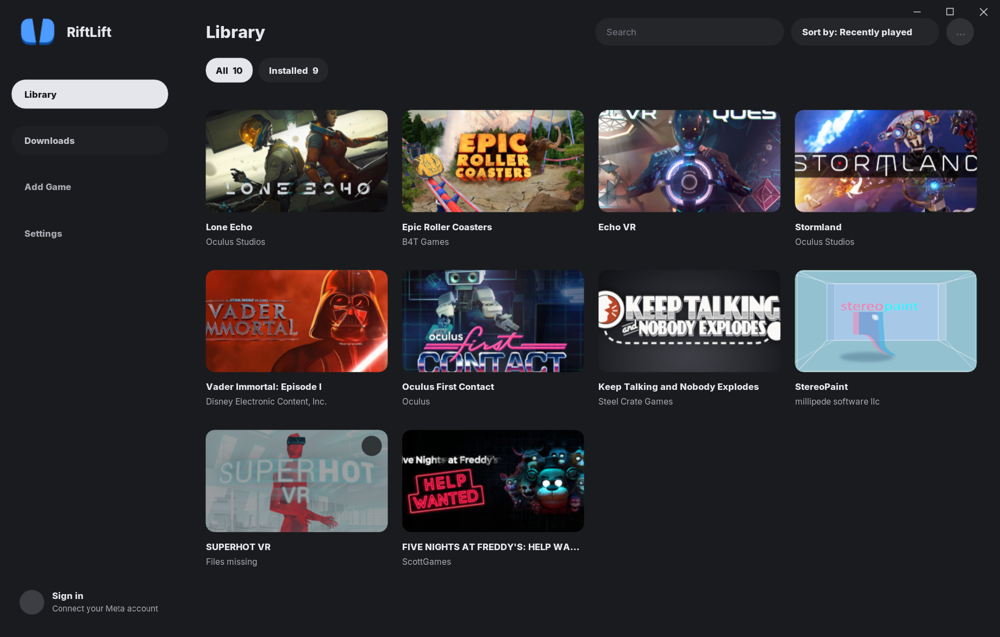
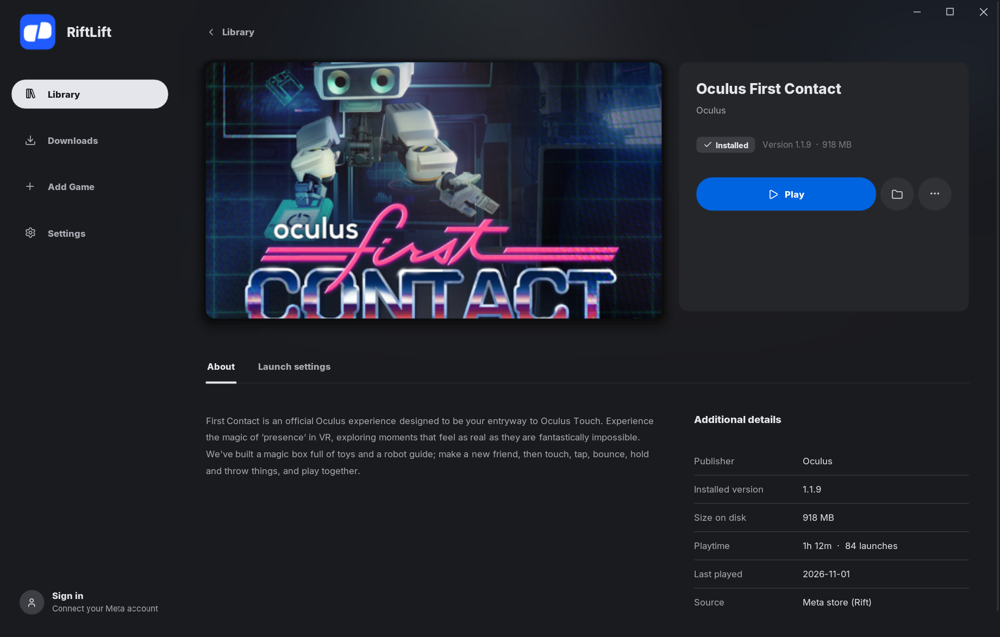
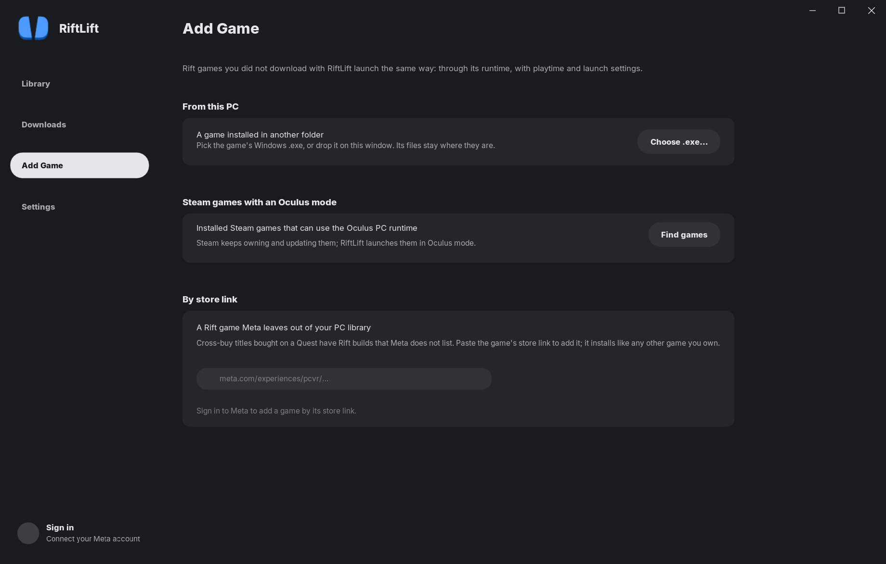

# RiftLift

**Play your Meta Rift (Oculus Rift) PC VR games on Windows and Linux.**

RiftLift signs in to your Meta account, downloads the Rift / PC VR games you
own, and launches them through the VR setup you already use (SteamVR or an
OpenXR runtime such as Monado).



> [!WARNING]
> RiftLift is alpha software. See the [compatibility wiki](docs/COMPATIBILITY.md)
> for tested games.

## Requirements

- A 64-bit Windows or Linux PC
- A VR headset that already works with SteamVR or another OpenXR runtime
- A Meta account that owns a **Rift / PC VR** game (Quest-only purchases are not
  PC games; cross-buy titles work)

RiftLift doesn't install headset drivers or VR runtimes.

## Install

**Windows:** download `RiftLift-windows64-setup.exe` from the
[latest release](https://github.com/Villagers654/RiftLift/releases/latest) and
run it. No administrator rights are needed. The installer isn't code-signed yet,
so if SmartScreen appears, choose **More info → Run anyway**. Meta sign-in uses
the Microsoft Edge WebView2 Runtime, which Windows 10 and 11 usually have. To
uninstall, use **Settings → Apps → Installed apps**. Your games and settings are
kept.

**Linux:** download `RiftLift-<version>-linux-x86_64.AppImage` from the
[latest release](https://github.com/Villagers654/RiftLift/releases/latest), make
it executable and run it. A `.tar.gz` of the same programs is there too. Games
run under GE-Proton, which RiftLift downloads the first time you play.

RiftLift tells you when a new version is out and can update itself in place.
Updating from the older Python-based RiftLift keeps your games, sign-ins,
playtime and launch settings.

## Getting started

1. **Sign in.** Click **Sign in** and finish Meta's sign-in page. Your password
   and security codes go only to Meta. Up to four Meta accounts can be signed
   in at once; their games appear together in your library.

2. **Install a game.** Pick one of your games in **Library** and click
   **Install**.

   

3. **Play.** Click **Play**. RiftLift picks your VR runtime automatically and
   tracks playtime locally. **Launch settings** on a game's page holds its
   launch options, Wine DLL overrides and environment variables.

   A game that checks its owner or Meta sign-in asks Meta while it runs, as
   the account it launched with; RiftLift itself never checks before
   starting a game. Games started without a signed-in account still run, but
   those checks then fail, so sign in with the account that owns the game.

### Add Game



- **From this PC:** choose a Rift game's `.exe` (or drop it on the window).
  RiftLift launches it in place, with playtime and launch settings.
- **Steam games with an Oculus mode:** finds installed Steam games that can use
  the Oculus PC runtime. Steam still owns and updates them; RiftLift launches
  them in Oculus mode.
- **By store link:** cross-buy games bought on a Quest have Rift builds Meta
  leaves out of your PC library. Paste the game's Rift store link to add it.

### Command line

`riftlift-cli` does what the window does: `library`, `install`, `play`,
`add` (an `.exe`, `--steam` games or a store link), `configure`, `accounts`,
`downloads` and more. Run `riftlift-cli --help` for everything. In the
AppImage, run it as `RiftLift-…AppImage cli --help`.

RiftLift's window and text are in English or French; **Settings → Language**
switches between them.

## Troubleshooting

If a game won't start:

1. Set **Settings → Log detail** to **Debug** and, on Linux, turn on
   **Debug logging** (Proton, graphics and crash logs). Try the game once more.
2. Click **Upload debug report** and put the link in a
   [new issue](https://github.com/Villagers654/RiftLift/issues).
   `riftlift-cli report GAME` writes the same report and prints its summary;
   add `--upload` for a link.

A report starts with what happened to the last run, its likely cause and what
to try next. It then lists:

- the state of every compatibility component;
- your system and VR runtime setup;
- the errors that every related log recorded during the run: Proton, the
  graphics and XRizer logs, the game's own logs, Steam, WiVRn and Envision, and
  the system journal.

Reports leave out your name, folders and account details.

Common fixes:

- **No VR runtime found:** start SteamVR (or your OpenXR runtime) and try again.
- **Meta asks you to sign in again:** click **Reconnect** on the account in
  **Settings → Accounts**.
- **A game says its files are missing:** Steam may have updated it; add it again
  from **Add Game**.

## Contributing

RiftLift is a native C++ app (Dear ImGui on SDL3) plus a runtime that translates
the Oculus API for each game.

| Path | What it is |
| --- | --- |
| `src/launcher/` | The window (`riftlift`) and the command line (`riftlift-cli`) |
| `src/common/` | Meta sign-in, store and downloads, the library, game records, playtime, Steam |
| `src/runtime/` | `riftlift-runtime`: sets up and starts one game (Proton on Linux, the bridges on Windows) |
| `runtime/` | C++ Oculus → OpenVR/OpenXR bridges and the Windows launcher, derived from [Revive](https://github.com/LibreVR/Revive) |
| `runtime/openxr-layer/` | OpenXR layer that lets OVRPlugin (Unity/Unreal) games use non-Oculus runtimes |
| `compat/` | Oculus Platform SDK compatibility shim |
| `components/xrizer/` | Submodule: RiftLift's [xrizer fork](https://github.com/Villagers654/xrizer) (OpenVR → OpenXR, Linux) |
| `scripts/`, `.github/workflows/` | Packaging and CI (AppImage, Windows installer, release payloads) |

On Windows, games run natively through the bridges. On Linux they run under
GE-Proton, and the bridges reach the host's OpenXR runtime or SteamVR through
Wine's in-process `unixlib` boundary.

**Build**

- Linux (clang 18 or newer, CMake, Ninja, and the OpenSSL, Wayland and
  libsecret headers): `cmake --preset linux-release && cmake --build build/linux-release`.
  `./install.sh` builds and installs your checkout for your user.
- Windows: `python scripts/bootstrap-windows.py` fetches the pinned llvm-mingw,
  CMake and Ninja into `.deps/`, then
  `.deps/cmake/bin/cmake --preset windows-release` and
  `.deps/cmake/bin/cmake --build build/windows-release`.

**Before opening a PR**

```bash
ctest --test-dir build/linux-release --output-on-failure
python3 -m pytest tests/tooling
```

`tests/tooling` compiles parts of the Windows bridges on the host. CI builds and
tests Linux and Windows. To test without hardware,
[`runtime/tests/steamvr-touch-sim`](runtime/tests/steamvr-touch-sim/README.md)
adds simulated Touch controllers to SteamVR's null headset.

## Credits and legal

RiftLift's Oculus API translation is derived from the MIT-licensed
[Revive](https://github.com/LibreVR/Revive) project; thanks to LibreVR and its
contributors.

RiftLift is unaffiliated with Meta, Oculus or Valve. It only downloads games your
Meta account owns, and the ownership checks games make while running are
answered by Meta for your account. It is compatibility software, not a DRM
bypass.

RiftLift is MIT-licensed. Bundled components keep their own licenses; see
[third-party notices](THIRD_PARTY_NOTICES.md).

## Star history

<a href="https://www.star-history.com/?type=date&repos=Villagers654%2FRiftLift">
 <picture>
   <source media="(prefers-color-scheme: dark)" srcset="https://api.star-history.com/chart?repos=Villagers654/RiftLift&type=date&theme=dark&legend=top-left&sealed_token=vpFI0AQgUej_RbdUU8YiyenZTK4Yztdp64p7xfU8enm1_6nreoY8RC6_R6pb9Xt5IprDK8Wnsy-OOpIULPGKabYF5lu3DeJI8RPvEseMStENO9BmhSLT4JrCaiFTUAhlkr6m3kJyat-sHGo_oFTht_YW1VJq04oQBvI-rUdAWrkQURYzvz2MEhpzDOL0" />
   <source media="(prefers-color-scheme: light)" srcset="https://api.star-history.com/chart?repos=Villagers654/RiftLift&type=date&legend=top-left&sealed_token=vpFI0AQgUej_RbdUU8YiyenZTK4Yztdp64p7xfU8enm1_6nreoY8RC6_R6pb9Xt5IprDK8Wnsy-OOpIULPGKabYF5lu3DeJI8RPvEseMStENO9BmhSLT4JrCaiFTUAhlkr6m3kJyat-sHGo_oFTht_YW1VJq04oQBvI-rUdAWrkQURYzvz2MEhpzDOL0" />
   
 </picture>
</a>
