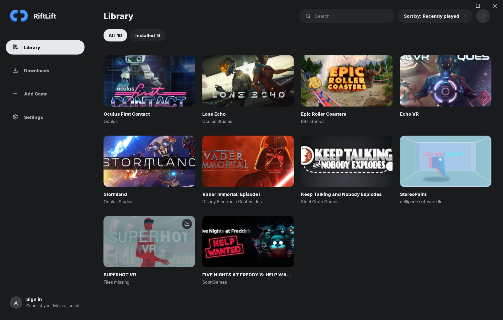
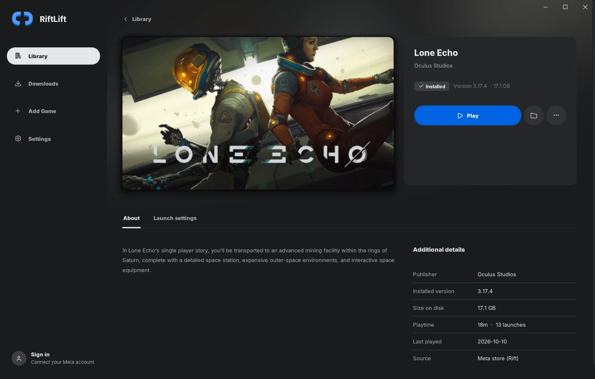
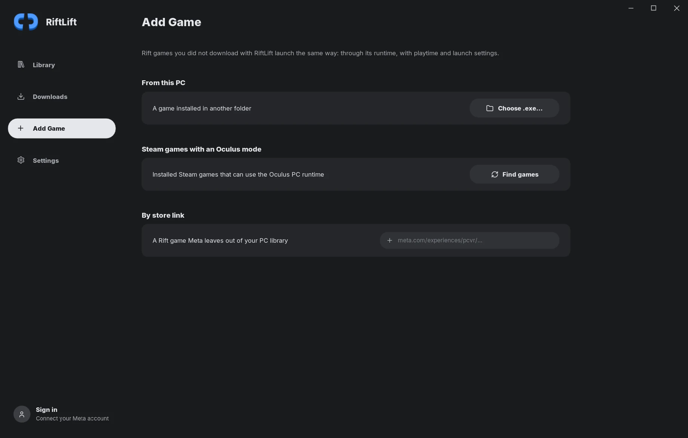

<div align="center">


# RiftLift

**Your Meta Rift library, on any PC VR headset.**

Download and play the Rift / PC VR games you own on Windows and Linux, through SteamVR or any OpenXR runtime.<br>
No Meta PC app. Free and open source.

[**Download**](https://github.com/Villagers654/RiftLift/releases/latest) · [Compatibility](docs/COMPATIBILITY.md) · [Report an issue](https://github.com/Villagers654/RiftLift/issues)



</div>

## Why RiftLift

- **Any headset.** Rift games run through the VR setup you already use: SteamVR, or an OpenXR runtime such as Monado or WiVRn. RiftLift doesn't install drivers or runtimes.
- **Linux too.** Games run under GE-Proton, which RiftLift downloads the first time you play. See the [compatibility wiki](docs/COMPATIBILITY.md) for tested games.
- **Your whole library.** Sign in with up to four Meta accounts; their games appear together. Steam games with an Oculus mode and games installed elsewhere join them.
- **Simple.** Sign in, install, press Play. RiftLift tracks playtime, keeps per-game launch settings and updates itself.

> [!WARNING]
> RiftLift is alpha software. Results vary with the game, runtime, driver and GPU.

### Install and play

You need a headset that already works with SteamVR or another OpenXR runtime, and a Meta account that owns a **Rift / PC VR** game. Quest-only purchases are not PC games; cross-buy titles work.

1. Download `RiftLift-windows64-setup.exe` from [Releases](https://github.com/Villagers654/RiftLift/releases/latest) and run it. No administrator rights are needed; the installer isn't code-signed yet, so if SmartScreen appears, choose **More info → Run anyway**.
   On Linux, install the package for your distribution (`.deb`, `.rpm`, AUR `riftlift-bin`, AppImage or Flatpak), or extract the `.tar.gz` anywhere.
2. Start RiftLift, choose **Sign in** and use the account that owns your Rift games. Your password and security codes go only to Meta.
3. Pick a game in your library and choose **Install**.
4. Start your headset's runtime, then choose **Play**.



**Launch settings** on a game's page hold its launch options, Wine DLL overrides and environment variables. A game that checks its owner asks Meta while it runs, as the account it launched with, so sign in with the account that owns it.

To keep an older build, or a beta beside the release, choose **… → Install another version…** on the game's page. Each version installs as its own game, so you can keep any or all of them.

Updating from the older Python-based RiftLift keeps your games, sign-ins, playtime and launch settings.

### Games from somewhere else

The **Add Game** page adds games that aren't in your Meta PC library:

- **From this PC:** choose a Rift game's `.exe` (or drop it on the window). RiftLift launches it in place.
- **Steam games with an Oculus mode:** choose **Find games**. Steam still owns and updates them; RiftLift launches them in Oculus mode, as a separate shortcut that leaves the normal Steam launch alone.
- **By store link:** cross-buy games bought on a Quest have Rift builds Meta leaves out of your PC library. Paste the game's Rift store link to add it.



### Command line

`riftlift-cli` does what the window does: `library`, `install`, `play`, `add` (an `.exe`, `--steam` games or a store link), `configure`, `accounts`, `downloads` and more. `riftlift-cli builds GAME` lists a game's versions and `install GAME --build VERSION` (or `--build all`) installs them. Run `riftlift-cli --help` for everything; in the AppImage, run `RiftLift-…AppImage cli --help`.

### Something wrong?

Set **Settings → Log detail** to **Debug** (and on Linux turn on **Debug logging**), try the game once more, then choose **Upload debug report** in Settings. RiftLift collects the last launch's logs into one report (Proton, graphics, XRizer, the game's own logs, Steam, WiVRn, Envision and the system journal) that starts with what happened, its likely cause and what to try next. It leaves out your name, folders and account details, and gives you a link to copy. `riftlift-cli report GAME --upload` does the same.

[Open an issue](https://github.com/Villagers654/RiftLift/issues) with the game, what happened and the report link. Common fixes:

- **No VR runtime found:** start SteamVR (or your OpenXR runtime) and try again.
- **Meta asks you to sign in again:** choose **Reconnect** on the account in **Settings → Accounts**.
- **Meta's sign-in window doesn't open, or you'd rather use your own browser:** [sign in manually](docs/MANUAL_SIGN_IN.md).
- **A game says its files are missing:** Steam may have updated it; add it again from **Add Game**.

### Build (Windows)

```sh
python scripts/bootstrap-windows.py          # pinned llvm-mingw, CMake and Ninja into .deps/
.deps/cmake/bin/cmake --preset windows-release
.deps/cmake/bin/cmake --build build/windows-release
```

### Build (Linux)

Needs clang 18 or newer, CMake, Ninja, and the OpenSSL, Wayland and libsecret headers. `./install.sh` builds and installs your checkout for your user.

```sh
cmake --preset linux-release
cmake --build build/linux-release
ctest --test-dir build/linux-release --output-on-failure
```

`scripts/packaging/linux/baseline.sh release` builds the release packages as CI does. RiftLift is a native C++ app (Dear ImGui on SDL3): the launcher and `riftlift-cli` are in `src/launcher/`, sign-in, store, downloads and the library in `src/common/`, and `riftlift-runtime`, which sets up and starts one game, in `src/runtime/`. The Oculus API bridges are in `runtime/`.

## License

RiftLift is licensed under GPL-v3: see [LICENSE](LICENSE).

It's built on other people's work, and we're grateful for it. Code from these projects is used under their own licenses; see [THIRD_PARTY_NOTICES.md](THIRD_PARTY_NOTICES.md):

| License | Whose code |
|---|---|
| [MIT](runtime/LICENSE) | [Revive](https://github.com/LibreVR/Revive), by LibreVR and its contributors: the Oculus API bridges |
| GPL-3.0 | [xrizer](https://github.com/Villagers654/xrizer) (RiftLift's fork): OpenVR on OpenXR, on Linux |
| Upstream licenses | [GE-Proton](https://github.com/GloriousEggroll/proton-ge-custom), by GloriousEggroll, downloaded when you first play on Linux |
| [ISC](THIRD_PARTY_NOTICES.md#lucide) | [Lucide](https://lucide.dev) icons |

Thank you to LibreVR and everyone who has worked on Revive, which made Rift games on other headsets possible; to the xrizer, Wine, Proton and DXVK projects that RiftLift runs games on; and to GloriousEggroll for GE-Proton.

RiftLift is not affiliated with Meta, Oculus or Valve. It only downloads games your Meta account owns, and the ownership checks games make while running are answered by Meta for your account. It is compatibility software, not a DRM bypass.

## Star history

<a href="https://www.star-history.com/?type=date&repos=Villagers654%2FRiftLift">
 <picture>
   <source media="(prefers-color-scheme: dark)" srcset="https://api.star-history.com/chart?repos=Villagers654/RiftLift&type=date&theme=dark&legend=top-left&sealed_token=vpFI0AQgUej_RbdUU8YiyenZTK4Yztdp64p7xfU8enm1_6nreoY8RC6_R6pb9Xt5IprDK8Wnsy-OOpIULPGKabYF5lu3DeJI8RPvEseMStENO9BmhSLT4JrCaiFTUAhlkr6m3kJyat-sHGo_oFTht_YW1VJq04oQBvI-rUdAWrkQURYzvz2MEhpzDOL0" />
   <source media="(prefers-color-scheme: light)" srcset="https://api.star-history.com/chart?repos=Villagers654/RiftLift&type=date&legend=top-left&sealed_token=vpFI0AQgUej_RbdUU8YiyenZTK4Yztdp64p7xfU8enm1_6nreoY8RC6_R6pb9Xt5IprDK8Wnsy-OOpIULPGKabYF5lu3DeJI8RPvEseMStENO9BmhSLT4JrCaiFTUAhlkr6m3kJyat-sHGo_oFTht_YW1VJq04oQBvI-rUdAWrkQURYzvz2MEhpzDOL0" />
   
 </picture>
</a>
