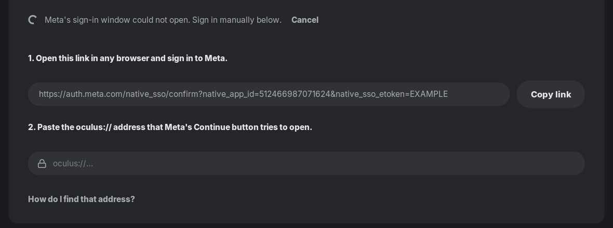
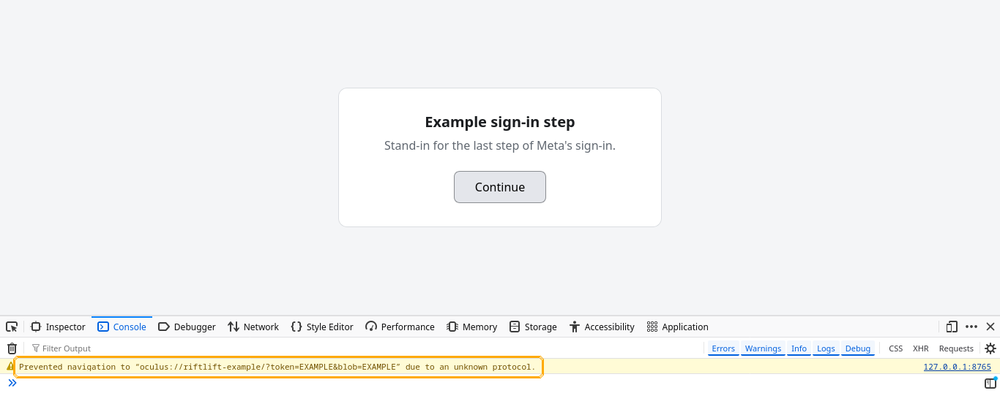

# Signing in manually

RiftLift normally signs you in through its own Meta sign-in window. Meta
finishes by sending that window to an address that starts with `oculus://`,
and RiftLift takes it from there.

## When to sign in manually

- RiftLift says **Meta's sign-in window could not open** (on Linux it needs
  WebKitGTK; on Windows, the Microsoft Edge WebView2 Runtime).
- You want to sign in with your usual browser instead.

Then sign in manually. Use **Firefox** for it: it shows the `oculus://` address
in its console. Chrome and Chromium don't show it anywhere.

### 1. Open the sign-in link

On the **Accounts** page, choose **Sign in with Meta**, then **Sign in
manually** (it is already open when the sign-in window couldn't open). Choose
**Copy link**, paste the link into Firefox, and sign in to Meta as usual.

From the command line, `riftlift-cli accounts sign-in --manual` prints the same
link and asks for the address.

### 2. Copy the oculus:// address

1. On Meta's last page, **Continue as …**, press **Ctrl+Shift+K**. Firefox's
   **Web Console** opens.
2. Click **Continue**. A yellow message appears: *Prevented navigation to
   "oculus://…" due to an unknown protocol.* If the console shows other
   messages too, type `oculus` into its **Filter Output** box so only that one
   is left.
3. Right-click the message and choose **Copy Message**, or select it and copy
   it with **Ctrl+C**.

If you clicked **Continue** before opening the console, just click it again.

### 3. Paste it into RiftLift

Back in RiftLift, paste into the field under step 2 and press **Enter**. You can
paste the whole console message: RiftLift picks out the `oculus://` address.

## Keep the address to yourself

The `oculus://` address signs in your Meta account. Paste it only into RiftLift
and never share it or post it in a screenshot. It works only once, and only for
the sign-in RiftLift is waiting for, so if something goes wrong, start a new
sign-in instead of reusing an old address.

The Firefox screenshot shows a stand-in page with example values, not a real
sign-in.
